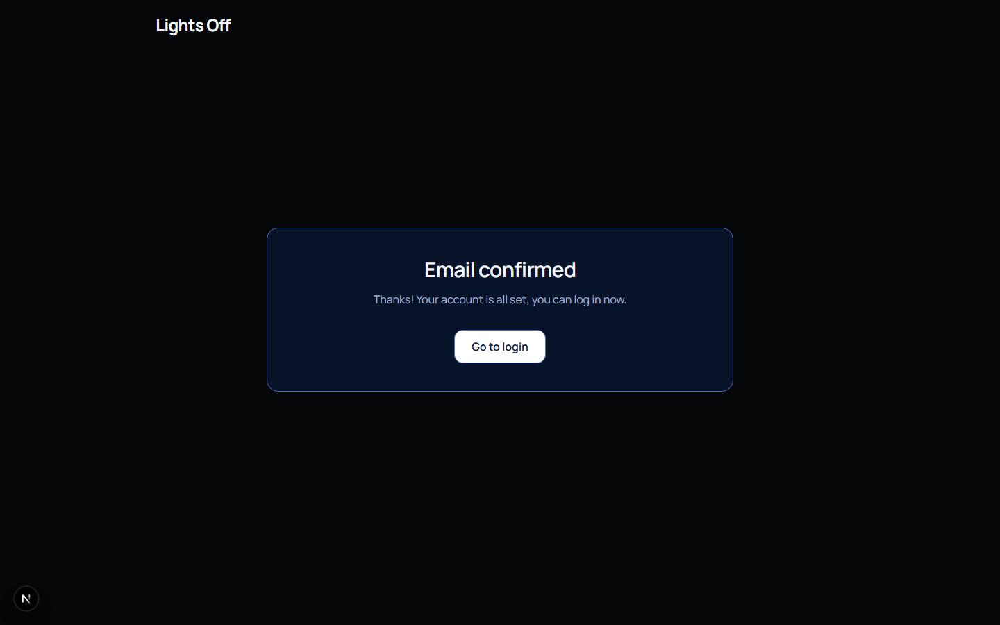
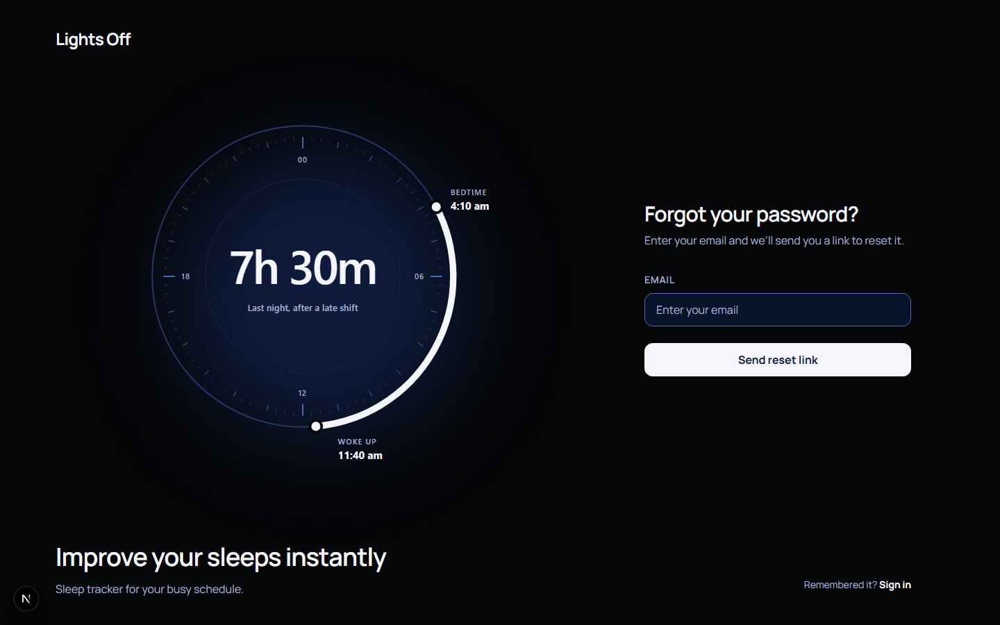
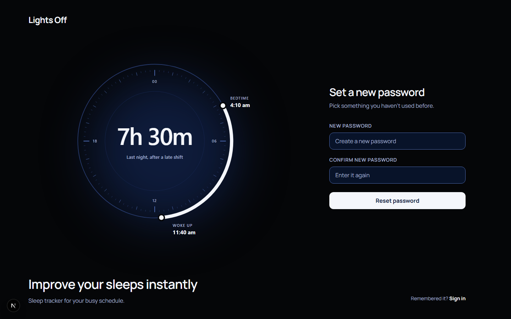
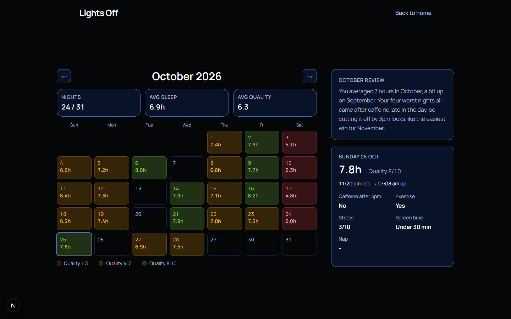
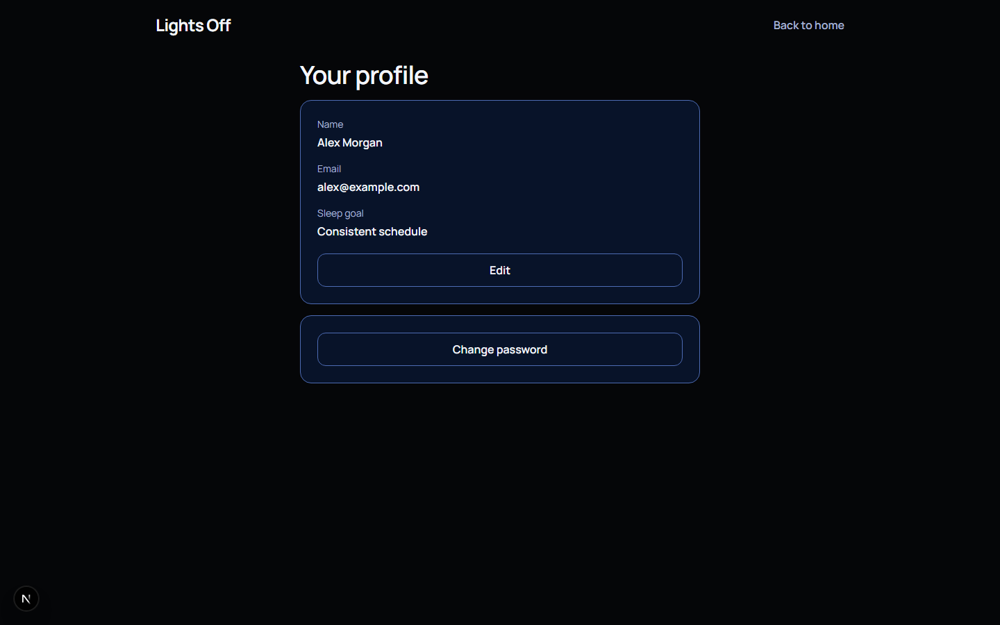
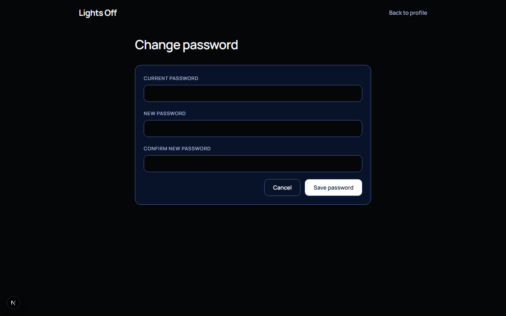

# Lights Off

Lights Off is a sleep tracking web application that helps users find out what affects their sleep. It's built for people with irregular schedules, like shift workers and students. Users log their sleep each night along with a few daily factors, and an AI sleep coach gives them short, personal feedback based on their own data.

## Status

In Development

## Features

- Sign up and log in with email and password, Google or Facebook
- Confirm your email before your first login (Google and Facebook accounts skip this), and get a new link if the first one went missing
- Reset your password by email if you forget it
- Log a night of sleep, with optional factors like caffeine, exercise and stress
- See your latest night on the home page
- Update last night's log
- See the month on a calendar, coloured by how well you slept, and tap a night for the details
- Go back through past months on the dashboard
- Set your name and sleep goals, change your password (for email accounts) and delete your account
- Get AI feedback on last night's sleep and a review of each month
- AI feedback is saved and rate limited to keep costs down

## Screenshots

### Login


### Register


### Confirm email



### Forgot password



### Reset password



### Home


### Log a night


### Update last night


### Dashboard



### Profile



### Change password



## Technology Stack

### Frontend

- Next.js
- TypeScript
- Tailwind CSS
- TanStack Query

### Backend

- ASP.NET Core Web API
- C#
- Entity Framework Core
- SQL Server
- ASP.NET Core Identity (cookie authentication)
- Google and Facebook OAuth
- MailKit (sending emails over SMTP)

### Testing

- xUnit

### External APIs

- Anthropic Claude API

## Getting Started

### Backend

1. Open `lo-backend` and set your connection string in `appsettings.json`.
2. Add these keys with User Secrets (`dotnet user-secrets set "<key>" "<value>"`):
   - `Authentication:Google:ClientId`
   - `Authentication:Google:ClientSecret`
   - `Authentication:Facebook:AppId`
   - `Authentication:Facebook:AppSecret`
   - `Anthropic:Api:Key`
   - `Smtp:Server`, `Smtp:Port`, `Smtp:Username`, `Smtp:Password`, `Smtp:SenderName`, `Smtp:SenderEmail` (with Gmail, the password has to be an app password, not your normal one)
3. Run `dotnet ef database update`, then `dotnet run`.

### Frontend

1. Open `lo-frontend` and create a `.env.local` file with:
   ```text
   NEXT_PUBLIC_API_URL=https://localhost:7152
   ```
2. Run `npm install`, then `npm run dev` and open http://localhost:3000.

## Future Implementations

- Implement RAG (OpenAI embeddings) so the monthly review can compare against similar past nights
- Deploy to Azure
- Send emails from my own domain through AWS SES, so they stop going to spam
- Backend Tests

## Project Structure

```text
Lights-Off/
├── lo-backend/            # ASP.NET Core Web API
│   ├── Controllers/       # API endpoints (authentication, sleep logs, sleep coach)
│   ├── Data/              # Database context
│   ├── Filters/           # Request validation filters
│   ├── Migrations/        # Database migrations
│   ├── Models/            # Database models, DTOs and enums
│   ├── Services/          # Sleep coach that calls the Claude API, and the email sender
│   └── Program.cs         # App setup
├── lo-backend.Tests/      # Backend tests
├── lo-frontend/           # Next.js frontend
│   ├── app/               # Pages (login, register, confirm-email, forgot-password, reset-password, home, log, update-log, dashboard, profile, change-password)
│   ├── components/        # Shared UI pieces and styles, plus a folder for each page's own pieces
│   ├── public/images/     # Screenshots for this README
│   └── type.ts            # TypeScript types for props and API data
└── README.md
```
