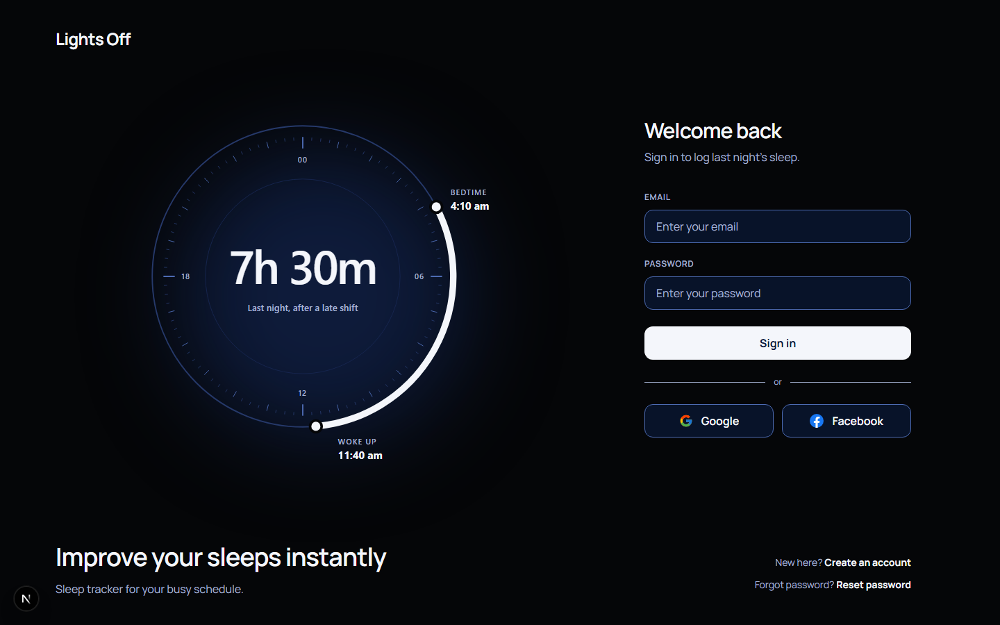
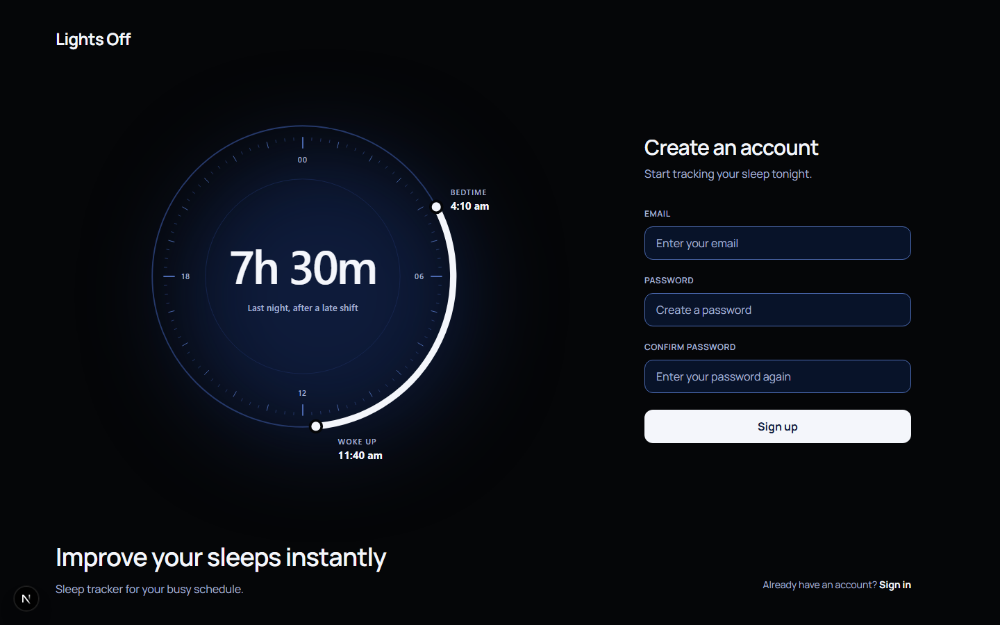
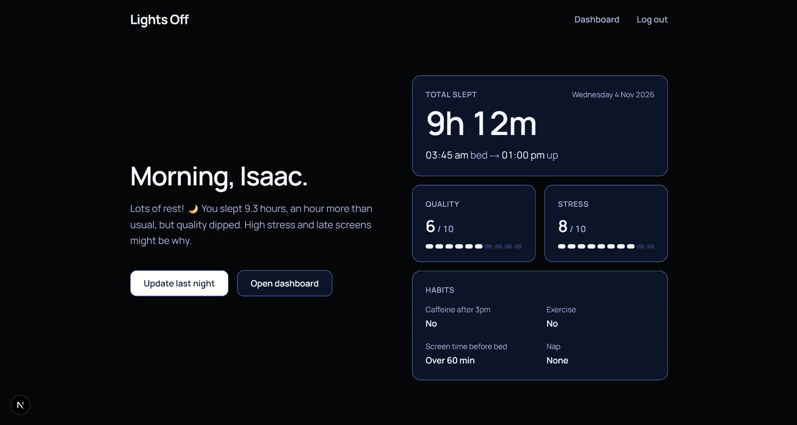
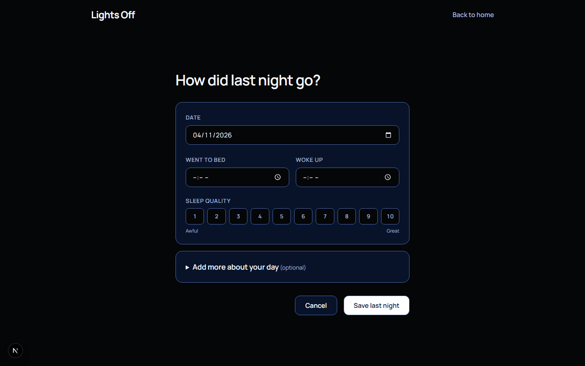
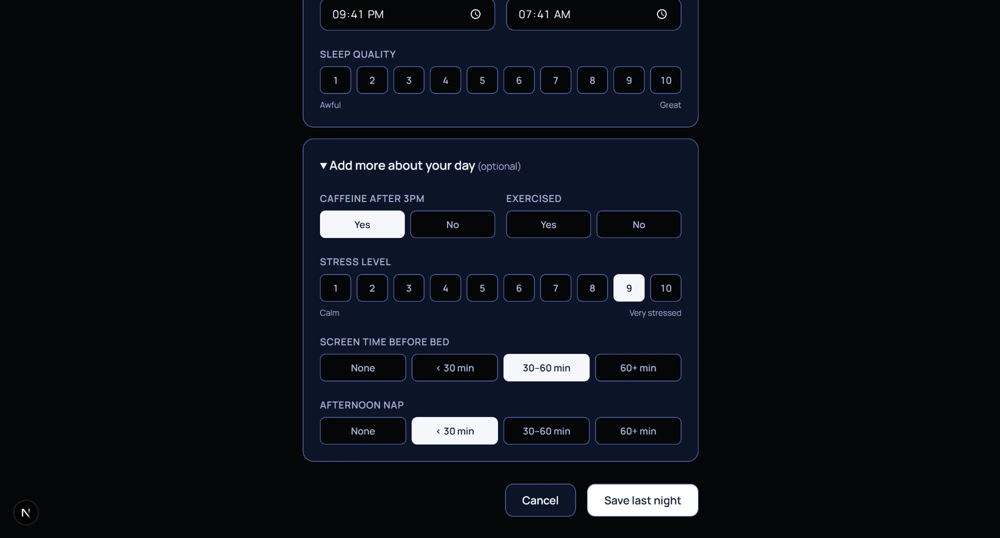
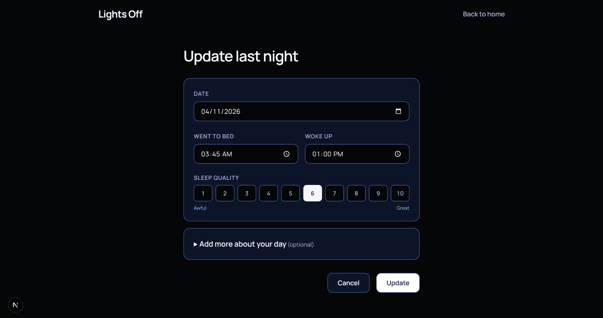

# Lights Off

Lights Off is a sleep tracking web application that helps users find out what affects their sleep. It's built for people with irregular schedules, like shift workers and students. Users log their sleep each night along with a few daily factors, and an AI sleep coach gives them short, personal feedback based on their own data.

## Status

In Development

The backend API is built. On the frontend, the login, register, home, log a night and update pages all work with the API. The dashboard is next.

## Features

- Sign up and log in with email and password, Google or Facebook
- Log a night of sleep, with optional factors like caffeine, exercise and stress
- See your latest night on the home page
- Update last night's log
- Get AI feedback on last night's sleep and a review of each month
- AI feedback is saved and rate limited to keep costs down

## Screenshots

### Login



### Register



### Home



### Log a night





### Update last night



## Technology Stack

### Frontend

- Next.js (App Router)
- TypeScript
- Tailwind CSS

### Backend

- ASP.NET Core Web API
- C#
- Entity Framework Core
- SQL Server
- ASP.NET Core Identity (cookie authentication)
- Google and Facebook OAuth
- Rate limiting
- Swagger UI

### Testing

- xUnit

### External APIs

- Anthropic Claude API

## Getting Started

### Backend

1. Open `lo-backend` and set your connection string in `appsettings.json`.
2. Add these keys with User Secrets (`dotnet user-secrets set "<key>" "<value>"`):
   - `Authentication:Google:ClientId`
   - `Authentication:Google:ClientSecret`
   - `Authentication:Facebook:AppId`
   - `Authentication:Facebook:AppSecret`
   - `Anthropic:Api:Key`
3. Run `dotnet ef database update`, then `dotnet run`.

### Frontend

1. Open `lo-frontend` and create a `.env.local` file with:
   ```text
   NEXT_PUBLIC_API_URL=https://localhost:7152
   ```
2. Run `npm install`, then `npm run dev` and open http://localhost:3000.

## Future Implementations

### Frontend
- Build the dashboard with a sleep calendar and monthly stats
- Show the full details of a night when a day is selected
- Show the monthly AI review on the dashboard
- Add a password reset page once the backend can send emails

### Backend
- Use RAG (OpenAI embeddings) so the monthly review can compare against similar past nights
- Add password reset and email verification
- Let users set a sleep goal and update their profile
- Let users delete their account
- Deploy to AWS

## Project Structure

```text
Lights-Off/
├── lo-backend/            # ASP.NET Core Web API
│   ├── Controllers/       # API endpoints (authentication, sleep logs, sleep coach)
│   ├── Data/              # Database context
│   ├── Filters/           # Request validation filters
│   ├── Migrations/        # Database migrations
│   ├── Models/            # Database models, DTOs and enums
│   ├── Services/          # Sleep coach that calls the Claude API
│   └── Program.cs         # App setup
├── lo-backend.Tests/      # Backend tests
├── lo-frontend/           # Next.js frontend
│   ├── app/               # Pages (login, register, home, log, update-log)
│   ├── components/        # Shared UI pieces and styles
│   ├── public/images/     # Screenshots for this README
│   └── type.ts            # TypeScript types for props and API data
└── README.md
```
